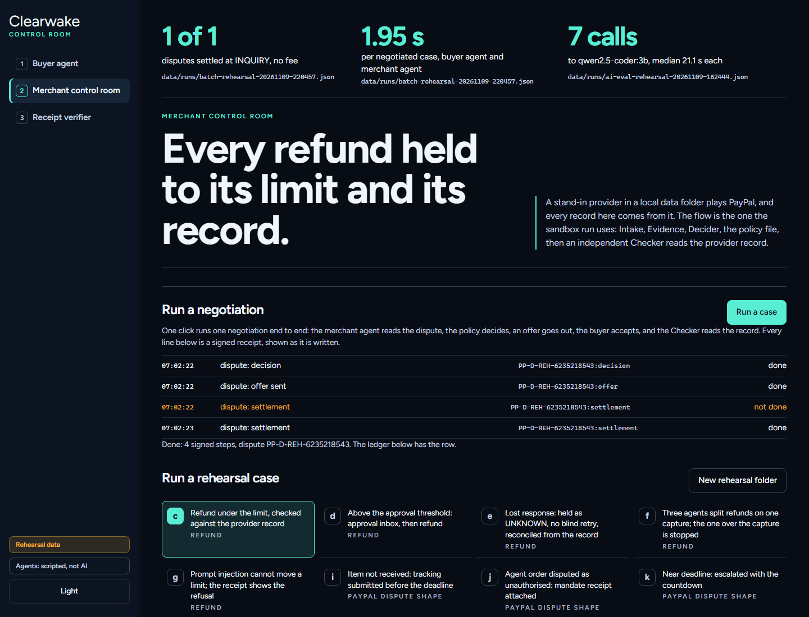
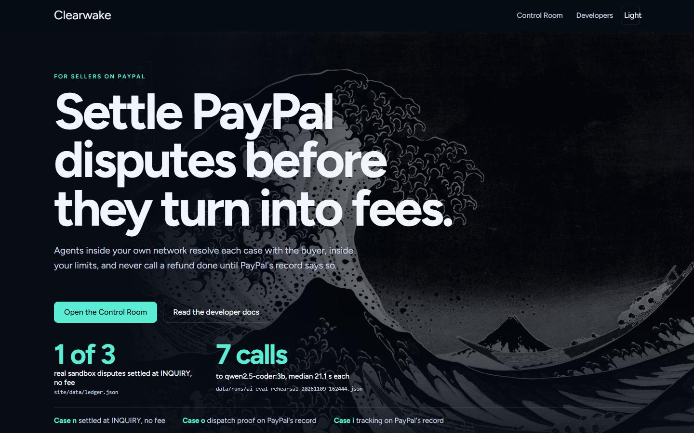

<!--
TODO for the lead before submission (remove this comment when done):
* Screenshots: docs/img/console-merchant.png and docs/img/site-home.png are made by agent C and did not exist when this README was written, so they are not referenced. Add them under the headline when the files exist:
    
    
* The three numbers under the headline come from data/runs/ files (batch by agent B, model calls by agent A); fill them first.
* Fill every [PLACEHOLDER] in the status table (list at the top of D:\paypal hackathon\DEVPOST_ENTRY.md).
-->
# Clearwake

**When an AI agent buys, Clearwake settles what goes wrong.** The buyer's agent and the merchant's agent resolve the dispute inside PayPal's own conversation, each within limits its owner signed, before it becomes a claim or a fee. PayPal's record decides when it is done, and both sides keep proof.

Measured, from the run files in `data/runs/`:

* **[BATCH_SETTLED] of [BATCH_TOTAL]** disputes opened by the buyer agent on the PayPal sandbox settled at the INQUIRY stage with no fee, as PayPal's record reads.
* **[BATCH_SECONDS_PER_CASE] seconds** per case, agent to agent, with [MODEL_CALLS] model calls.
* **1 refund instead of 2** after a lost response, and a 5000.00 claim refused instead of paid, against PayPal's agent toolkit on the same injected faults (no network) ([docs/TOOLKIT_FAILURE_CASES.md](docs/TOOLKIT_FAILURE_CASES.md)).

```sh
git clone --recurse-submodules https://github.com/Sriharsan/clearwake.git && cd clearwake && python -m clearwake --port 8810
```

Open http://127.0.0.1:8810/console. Python 3.12 or newer, nothing to install. Windows: `.\demo.ps1`. macOS or Linux: `./demo.sh`. The network isolated run (case m) needs Docker: `python scripts/airgap.py`.

* Public site (recorded sandbox run, receipt verifier in your browser): https://clearwake-mu.vercel.app
* Live console, hosted on Render, not network isolated: [RENDER_URL]
* Video: [VIDEO_URL]
* API: [OpenAPI 3.1 spec](openapi/clearwake-console.openapi.yaml), [Postman collection](postman/clearwake-paypal.postman_collection.json)

How it runs: locally the console is a rehearsal with no PayPal calls; every PayPal sandbox run is listed in the status table below with its ids. Sandbox means PayPal's test environment with test money. No live PayPal, no real money.

**License:** MIT.

## What happens

1. The buyer's agent buys a parcel inside a mandate its owner signed (budget, per item cap, store, categories). The mandate is signed and linked to the PayPal order.
2. One item is missing. The buyer's agent opens the dispute in PayPal's Resolution Center as the sandbox buyer, through a browser on the owner's own machine, and its owner's dispute rule says what it may accept (for example any refund of 80 percent or more for a missing item).
3. The merchant's agent reads the dispute and the buyer's message. A local model proposes settle, fight or escalate. The policy file decides. Code checks every amount and every cited id. The agent checks its dispatch proof, then sends a message and an offer through PayPal's `send-message` and `make-offer`.
4. The buyer's agent accepts within its rule. Both sides write signed receipts.
5. Clearwake says "settled, no fee" only when PayPal's own record reads RESOLVED at the INQUIRY stage.

## The money leak

PayPal's own rules ([help350](https://history.paypal.com/uk/cshelp/article/how-is-the-dispute-rate-calculated-and-how-do-i-avoid-being-charged-a-dispute-fee-help350), UK edition; fees from [PayPal Merchant Fees, US](https://www.paypal.com/us/business/paypal-business-fees), updated 1 Oct 2026; both in [docs/SOURCES.md](docs/SOURCES.md)):

1. No Standard Dispute Fee (USD 15.00 in the US) is charged when a case is resolved directly between seller and buyer and not escalated to a claim. Sellers who answer late, or only with evidence, let cases escalate.
2. A seller with more than 100 sales in the previous 3 months and a dispute rate of 1.5% or more pays the High Volume Dispute Fee (USD 30.00 in the US) on every dispute.
3. A refund sent twice, or one that silently failed, costs money or a customer. Clearwake gives each refund one stable request id, holds what it cannot confirm as UNKNOWN, and checks PayPal's record before calling it done.

The Standard fee is not charged on claims below twice the fee or on unauthorised transactions, so the fee leak gauge counts a fee avoided only when PayPal's rule would otherwise have charged one.

## Without Clearwake and with it

| Moment | Without Clearwake | With Clearwake |
| --- | --- | --- |
| An agent's order goes wrong | The buyer's complaint waits in an inbox; the owner of the agent finds out later | The buyer's agent opens the dispute and negotiates inside its owner's rule |
| A buyer opens a case | No reply in time; the case escalates and the dispute fee is charged | Settled in conversation: `send-message` and `make-offer` inside the owner's limit while the case is an inquiry; "settled, no fee" only when PayPal's record shows it RESOLVED at the INQUIRY stage |
| A case worth fighting | Deadline missed; evidence never sent | Tracking and order facts from PayPal's records, sent before the deadline; near deadlines go to the owner with a countdown |
| A refund reply is lost | Sent twice, or marked done when it failed | One request id, held as UNKNOWN, reconciled from PayPal's record |
| Dispute text and buyer details | Pasted into an outside AI service | Read by a local model inside the merchant's network |
| The network drops mid batch | Retries fire blindly | Money actions wait as "held, offline"; on reconnect PayPal is read first, then they finish with no duplicate |

## The boundary

The live system runs in a network isolated Docker network (`compose.airgap.yml`, `internal: true`) on the merchant's own machine. The egress gateway from [verdock-core](https://github.com/Sriharsan/verdock-core) is the only service with a route out. It allows only the hosts in [policy/merchant.yaml](policy/merchant.yaml) (`api-m.sandbox.paypal.com`) and signs a receipt for every request it sees, allowed or blocked. The hosted console on Render and the public site on Vercel are not part of this boundary.

| Stays inside | Crosses the gateway | Why |
| --- | --- | --- |
| Dispute text, buyer messages, evidence drafts | Only what PayPal's API needs for the step: a message, an offer amount, tracking facts | Customer data and dispute evidence stay inside the merchant's environment |
| Policy file, approvals, limits | Nothing | A buyer message or a model reply cannot change a limit |
| Signed receipts and the verifier | Nothing | Proof that does not depend on any outside service |
| The model (Ollama, in its own container on the isolated network) | Nothing | Dispute text never goes to an outside AI |
| Sandbox keys | Inside the TLS tunnel only; the gateway sees host names and byte counts | The gateway can log every request without reading it |

A request the gateway refuses before it leaves (403 off the allowlist, 502 when its own network is down) is known not to have happened, so Clearwake holds it as "held, offline" instead of UNKNOWN. Case m cuts the gateway's network mid batch and restores it; see [docs/SANDBOX_RUN.md](docs/SANDBOX_RUN.md).

## Dispatch proof

Some disputes are about what was in the box. At packing the merchant photographs the open parcel. SAM, an open weights model from Meta, runs on the merchant's own machine, counts the items and writes one signed receipt into the same receipt chain: the PayPal order id and capture id, the items ordered and counted, the SHA-256 of each photo, whether the parcel was sealed, how it was counted, and the policy hash. Nothing goes to an outside AI.

When a buyer says some items did not arrive, the Evidence agent finds that receipt in the verified log and checks it against the order and the tracking:

* **Strong proof** (the count matches the order, the parcel is sealed, tracking shows it shipped, and the log verifies) is sent as evidence through `provide-evidence` before the deadline, with the photo attached. The Checker reads PayPal's dispute back and says whether PayPal's record shows the dispatch proof.
* **Weak proof** is never sent. The policy settles by offer while the case is an inquiry, refunds within the limit, or escalates to the owner.
* The buyer's words are read only as a claim to check, for example "only 2 of 3 arrived". They never decide an amount or an action.

```sh
python scripts/dispatch.py pack --order <order id> --capture <capture id> --item notebook-a5=3:notebook --photo parcel.jpg --sealed
python scripts/cases.py --only o       # rehearsal: strong proof sends evidence, weak proof settles by offer
```

Still photos use **SAM 3** (`facebook/sam3`). Meta's SAM 3.1 checkpoint is the video tracker, and Clearwake does not claim to count photos with it. The model name, device and milliseconds are written into every receipt. SAM and its weights are gated on Hugging Face and need a one time setup that you run yourself: [tools/sam/README.md](tools/sam/README.md). SAM Materials are under the SAM License; credits are in [docs/THIRD_PARTY.md](docs/THIRD_PARTY.md). What is real: SAM 3 counted three notebooks in a CC0 test photo offline on this laptop's CPU (15 s to load, 56 s to count), the signed receipt was written, and PayPal's sandbox accepted the evidence with the photo on dispute `PP-R-UKF-10195772`.

## Status

| What | How it ran | Result |
| --- | --- | --- |
| Agent to agent batch: [BATCH_TOTAL] sandbox orders bought and disputed by the buyer agent | real sandbox, buyer agent through a local browser, merchant agent with a local model | [BATCH_SETTLED] settled at INQUIRY with no fee, [BATCH_EVIDENCE] evidence sent, [BATCH_ESCALATED] escalated to the owner, [BATCH_REFUNDS] refunds confirmed by PayPal's record, [BATCH_SECONDS_PER_CASE] s per case. A bracket means that run is not recorded yet |
| Merchant agent, model calls | recorded run files | [MODEL_CALLS] model calls with `[MODEL_NAME]`, timings in [docs/RESULTS.md](docs/RESULTS.md) |
| Case n, settled in conversation | **real sandbox**, dispute `PP-R-OBG-10196144` | PASS: offer of USD 2.50, PayPal paid the settlement (refund `0TB11858A85953644`), the case read RESOLVED at the INQUIRY stage, never a claim, no fee. The sandbox buyer opened it and accepted by hand |
| Case o, dispatch proof | **real sandbox**, SAM 3 on the CPU, CC0 test photo | PASS (3 November): 3 of 3 counted, receipt `8b92abb9e53a6244`; dispute `PP-R-UKF-10195772`; PayPal's record shows the dispatch proof, tracking and photo from the seller. First try refused by PayPal, second lost and held UNKNOWN, third accepted |
| Case m, network cut mid batch (`scripts/airgap.py`) | real sandbox, network isolated containers, egress gateway | PASS: refund `6PX35920F4587564U` before the cut; two refunds held offline; after reconnect `76C086475Y724052F` and `9C434129FA2384059` VERIFIED, no duplicate; receipts verified with networking disabled |
| Case i (real PayPal dispute) | real sandbox | PASS on `PP-R-SLI-10195419`: tracking sent as the supporting info PayPal offered, read back VERIFIED |
| Cases c, d, e (`scripts/cases.py --sandbox`) | real sandbox; e is an injected fault in sandbox | PASS, twice on 31 October. Latest refunds `6SN41486G5579815G` and `2NB27940EC188891M` VERIFIED |
| Four refund cases (`scripts/check_sandbox.ps1`) | real sandbox | 4 of 4 PASS. Refunds `79R527888E694933F` and `7A545589JM079780C` COMPLETED |
| Cases a to o (`scripts/cases.py`) | rehearsal, no PayPal calls | 15 of 15 PASS (1 November) |
| Cases k, l (a dispute near its deadline, ten at once) | real sandbox | Not run on the sandbox on their own: k needs a dispute close to its deadline. The batch above replaces l |
| Console (`/console`), AG Grid dispute ledger and fee leak gauge | rehearsal locally; hosted at [RENDER_URL] | runs |
| Public site, https://clearwake-mu.vercel.app | static on Vercel, recorded sandbox run | verifies the real case m receipts in the browser |
| Tests | offline | [TESTS_PY] Python and [TESTS_UI] UI tests pass |
| Postman collection, 18 requests | checked offline; run against the sandbox by Sri | structure and scripts verified ([docs/POSTMAN.md](docs/POSTMAN.md)); sandbox run [POSTMAN_RUN] |

Every number is in [docs/RESULTS.md](docs/RESULTS.md) and [docs/SANDBOX_RUN.md](docs/SANDBOX_RUN.md), from the run files in `data/runs/` and `data/airgap/`.

## AI tools used

* **Merchant agent: a local model through Ollama, [MODEL_NAME].** It reads each dispute and buyer message, proposes settle, fight or escalate, and writes the reply and the offer note. It runs in its own container inside the isolated network. The policy decides; code checks every amount and cited id. Each call is recorded in the signed receipts.
* **Buyer agent.** Picks a product and handles the dispute inside the owner's mandate and dispute rule. Every step is receipted and linked to the mandate receipt.
* **SAM 3** counts items in packing photos on the merchant's machine for the dispatch proof.
* **Scripted fallback.** Fixed rules, labelled "scripted, not AI" on screen and in every run file, used when no model is running.

Models only propose. The limits live in [policy/merchant.yaml](policy/merchant.yaml), read by the server and never by a model: refunds up to USD 2.00 run alone, up to USD 5.00 need an approval, anything above is refused; offers to settle up to USD 3.00 run alone, up to USD 5.00 need an approval, and above that a partial offer of USD 5.00 goes to the owner; one customer is capped at USD 6.00 a day.

## Sponsor tools

| Tool | What it does here |
| --- | --- |
| AG Grid Community 35.3.1 (MIT) | The dispute ledger: stage filter, deadline countdown, model proposal next to the policy decision, PayPal's raw record in the row detail, CSV export for the accountant |
| Render | Hosts the live console ([docs/RENDER.md](docs/RENDER.md)) |
| APIMatic | OpenAPI 3.1 spec of the console API, SDK and portal, Context Plugin review of the PayPal calls ([docs/APIMATIC.md](docs/APIMATIC.md)) |
| Postman | A collection of every PayPal call Clearwake makes, with tests on PayPal's responses ([docs/POSTMAN.md](docs/POSTMAN.md)) |

Tools that were considered and left out, each with its reason, are in [docs/DESIGN_DECISIONS.md](docs/DESIGN_DECISIONS.md).

## Shared engine: verdock-core

Policy decisions, approvals, swarm invariants (locks, caps per capture and per customer per day, one stable request id per action), outcome states with reconciliation, signed receipts with an offline verifier, the egress gateway and the held queue all come from [verdock-core](https://github.com/Sriharsan/verdock-core) v0.2.0, MIT, pinned as a git submodule at `vendor/verdock-core`. It uses the Python standard library only. Clearwake adds the PayPal adapter, the agents and the screens. The server, sessions and CSRF protection come from [Relayloom](https://github.com/Sriharsan/relayloom), also MIT and pinned at `vendor/relayloom`. `clearwake/controller.py` and the refund screens are an internal module inherited from it, not part of the product.

## Where this goes

Built today on PayPal: agent to agent settling inside the dispute conversation, the per dispute policy decision, the fee leak gauge, agents in a network isolated environment with one receipted gateway, limits outside the model, recorded approvals, swarm invariants, a separate check of every money movement against PayPal's record, and signed receipts on both sides.

Planned, not built: shared context for teams of people and agents, continuous daily operations, and receipts accepted by payment platforms as proof. Details in [docs/VISION.md](docs/VISION.md).

## Cases, one command each

```sh
python scripts/cases.py                         # rehearsal, a to o, no network
python scripts/cases.py --sandbox               # real sandbox where PayPal allows it (keys in .env)
python scripts/cases.py --sandbox --only i --dispute <dispute id>   # one real dispute, read by id
python scripts/cases.py --sandbox --order <order id>                # case a after a sandbox buyer approval
python scripts/airgap.py                        # case m: network isolated containers, cut and restore (Docker, keys in .env)
python -m unittest discover -s tests            # offline tests
python openapi/check_openapi.py --live          # the OpenAPI spec against the running console
python postman/check_collection.py              # the Postman collection, offline
```

Every line prints PASS, FAIL or SKIPPED with how it ran, and the run is saved to `data/runs/`. Sandbox setup: copy `.env.example` to `.env`, add your own sandbox app keys, then run `scripts/sandbox_setup.ps1` once and approve the order as the sandbox personal buyer.

Submission notes: [SUBMISSION_PAYPAL.md](SUBMISSION_PAYPAL.md). Changes during the hackathon: [docs/HACKATHON_UPDATES.md](docs/HACKATHON_UPDATES.md).

## Uncertain outcomes

Unknown, pending or interrupted money actions keep their original `PayPal-Request-Id`. There is no automatic refund retry, second request identity, or "reverse a refund" action. Reconciliation is an explicit read of a known refund id that validates amount, USD currency, the sandbox capture link, the request correlation and the final status. A verified outcome needs `COMPLETED` from that read. Never delete a real sandbox ledger or switch databases to get around a held payment: unresolved cases need explicit operator review.
