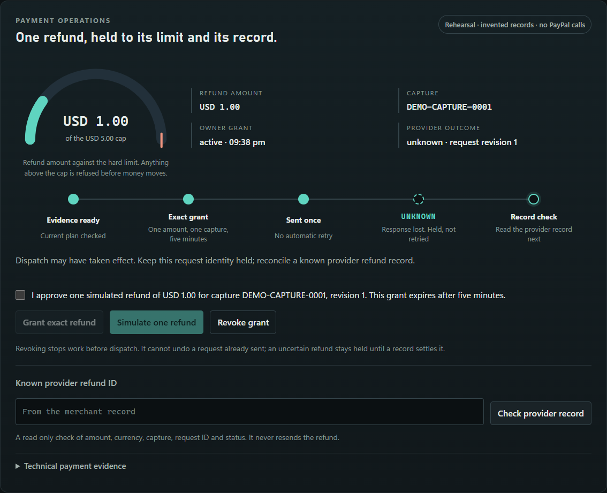

# Clearwake

Clearwake settles PayPal disputes before they turn into fees. Agents running inside the merchant's own network resolve each case with the buyer inside the owner's limits, fight only the cases worth fighting, and never call a refund done until PayPal's own record says so.

```sh
git clone --recurse-submodules https://github.com/Sriharsan/clearwake.git && cd clearwake && python -m clearwake --port 8810
```

Public site (static, recorded sandbox run, receipt verifier in your browser): https://clearwake-mu.vercel.app. It is not part of the network isolated system and runs no agents.

Open http://127.0.0.1:8810/console for the three screens (buyer agent, merchant control room with the dispute ledger, receipt verifier), or http://127.0.0.1:8810 for the refund workroom. Python 3.12 or newer, nothing to install. Windows: `.\demo.ps1`. macOS or Linux: `./demo.sh`. The network isolated run (case m) needs Docker: `python scripts/airgap.py`.



*Screenshot: the refund workroom in rehearsal mode, invented records, fake provider.*

**License:** MIT.

## The money leak

PayPal's own rules ([help350](https://history.paypal.com/uk/cshelp/article/how-is-the-dispute-rate-calculated-and-how-do-i-avoid-being-charged-a-dispute-fee-help350), UK edition; fees from [PayPal Merchant Fees, US](https://www.paypal.com/us/business/paypal-business-fees), updated 1 Oct 2026; both in [docs/SOURCES.md](docs/SOURCES.md)):

1. No Standard Dispute Fee (USD 15.00 in the US) is charged when a case is resolved directly between seller and buyer and not escalated to a claim. Sellers who answer late, or only with evidence, let cases escalate.
2. A seller with more than 100 sales in the previous 3 months and a dispute rate of 1.5% or more pays the High Volume Dispute Fee (USD 30.00 in the US) on every dispute.
3. A refund sent twice, or one that silently failed, costs money or a customer. Clearwake gives each refund one stable request id, holds what it cannot confirm as UNKNOWN, and checks PayPal's record before calling it done.

The Standard fee is not charged on claims below twice the fee or on unauthorised transactions, so the fee leak gauge counts a fee avoided only when PayPal's rule would otherwise have charged one.

## Who it is for

Small PayPal merchants who lose money on disputes: cases that escalate because nobody answered in time, evidence that never went out before the deadline, refunds sent twice. Clearwake reads each dispute, and the policy decides per case: settle in conversation with an offer inside the owner's limit while PayPal still calls it an inquiry, fight with the order, capture and tracking from PayPal's own records, refund within the limit, or put it in the owner's inbox before the deadline. The model only proposes; its proposal is shown next to the policy's decision. Every action is checked afterwards against PayPal's record and written to a signed receipt that anyone can verify offline.

When the buyer is an AI agent, Clearwake also signs the owner's spending mandate on the buyer side (a cart mandate in AP2 terms) and links it to the PayPal order, so the merchant can attach it as evidence if the order is disputed as unauthorised (case j).

## Without Clearwake and with it

| Moment | Without Clearwake | With Clearwake |
| --- | --- | --- |
| A buyer opens a case | No reply in time; the case escalates and the dispute fee is charged | Settled in conversation: `send-message` and `make-offer` inside the owner's limit while the case is an inquiry; "settled, no fee" only when PayPal's record shows it RESOLVED at the INQUIRY stage |
| A case worth fighting | Deadline missed; evidence never sent | Tracking and order facts from PayPal's records, sent before the deadline; near deadlines go to the owner with a countdown |
| A refund reply is lost | Sent twice, or marked done when it failed | One request id, held as UNKNOWN, reconciled from PayPal's record |
| Dispute text and buyer details | Pasted into an outside AI service | Read by a local model inside the merchant's network |
| The network drops mid batch | Retries fire blindly | Money actions wait as "held, offline"; on reconnect PayPal is read first, then they finish with no duplicate |

## The boundary

The live system runs in a network isolated Docker network (`compose.airgap.yml`, `internal: true`) on the merchant's own machine. The egress gateway from [verdock-core](https://github.com/Sriharsan/verdock-core) is the only service with a route out. It allows only the hosts in [policy/merchant.yaml](policy/merchant.yaml) (`api-m.sandbox.paypal.com`) and signs a receipt for every request it sees, allowed or blocked. The hosted public site is not part of this boundary.

| Stays inside | Crosses the gateway | Why |
| --- | --- | --- |
| Dispute text, buyer messages, evidence drafts | Only what PayPal's API needs for the step: a message, an offer amount, tracking facts | Customer data and dispute evidence stay inside the merchant's environment |
| Policy file, approvals, limits | Nothing | A buyer message or a model reply cannot change a limit |
| Signed receipts and the verifier | Nothing | Proof that does not depend on any outside service |
| The model (Ollama, in its own container on the isolated network) | Nothing | Dispute text never goes to an outside AI |
| Sandbox keys | Inside the TLS tunnel only; the gateway sees host names and byte counts | The gateway can log every request without reading it |

A request the gateway refuses before it leaves (403 off the allowlist, 502 when its own network is down) is known not to have happened, so Clearwake holds it as "held, offline" instead of UNKNOWN. Case m cuts the gateway's network mid batch and restores it; see [docs/SANDBOX_RUN.md](docs/SANDBOX_RUN.md).

## Dispatch proof

Some disputes are about what was in the box. At packing the merchant photographs the open parcel. SAM, an open weights model from Meta, runs on the merchant's own machine, counts the items and writes one signed receipt into the same receipt chain: the PayPal order id and capture id, the items ordered and counted, the SHA-256 of each photo, whether the parcel was sealed, how it was counted, and the policy hash. Nothing goes to an outside AI.

When a buyer says some items did not arrive, the Evidence agent finds that receipt in the verified log and checks it against the order and the tracking:

* **Strong proof** (the count matches the order, the parcel is sealed, tracking shows it shipped, and the log verifies) is sent as evidence through `provide-evidence` before the deadline, with the photo attached. The Checker reads PayPal's dispute back and says whether PayPal's record shows the dispatch proof.
* **Weak proof** is never sent. The policy settles by offer while the case is an inquiry, refunds within the limit, or escalates to the owner.
* The buyer's words are read only as a claim to check, for example "only 2 of 3 arrived". They never decide an amount or an action.

```sh
python scripts/dispatch.py pack --order <order id> --capture <capture id> --item notebook-a5=3:notebook --photo parcel.jpg --sealed
python scripts/cases.py --only o       # rehearsal: strong proof sends evidence, weak proof settles by offer
```

Which model: still photos use **SAM 3** (`facebook/sam3`). Meta's **SAM 3.1** checkpoint is the video tracker, and Clearwake does not claim to count photos with it. The model name, device and milliseconds are written into every receipt. SAM and its weights are gated on Hugging Face and need a one time setup that you run yourself: [tools/sam/README.md](tools/sam/README.md). SAM Materials are under the SAM License; credits are in [docs/THIRD_PARTY.md](docs/THIRD_PARTY.md). What is real: SAM 3 counted three notebooks in a photo offline on this laptop's CPU (15 s to load, 56 s to count), the signed receipt was written, and PayPal's sandbox accepted the evidence with the photo on dispute `PP-R-UKF-10195772`. Weak proof and the rest are covered by tests and run in rehearsal with a scripted count, labelled "scripted count, not SAM". A real SAM 3 count on a CC0 test photo (not a real parcel) and a real sandbox dispute were run on 3 November 2026: see Status and docs/RESULTS.md.

## Status

| What | How it ran | Result |
| --- | --- | --- |
| Cases a to o (`scripts/cases.py`) | rehearsal, fake provider, invented records | 15 of 15 PASS (1 November) |
| Case o, dispatch proof | **real sandbox**, SAM 3 on the CPU, CC0 test photo | PASS (3 November): 3 of 3 counted, receipt `8b92abb9e53a6244`; dispute `PP-R-UKF-10195772`; PayPal's record shows the dispatch proof, tracking and photo from the seller. First try refused by PayPal, second lost and held UNKNOWN, third accepted |
| Case o, weak proof | rehearsal, scripted count | PASS: weak proof is not sent, the policy settles by offer instead |
| Cases c, d, e (`scripts/cases.py --sandbox`) | real sandbox; e is an injected fault in sandbox | PASS, twice on 31 October. Latest refunds `6SN41486G5579815G` and `2NB27940EC188891M` VERIFIED |
| Case m, network cut mid batch (`scripts/airgap.py`) | real sandbox, network isolated containers, egress gateway | PASS: refund `6PX35920F4587564U` before the cut; two refunds held offline; after reconnect `76C086475Y724052F` and `9C434129FA2384059` VERIFIED, no duplicate; receipts verified with networking disabled |
| Case i (real PayPal dispute) | real sandbox | PASS on `PP-R-SLI-10195419`: tracking sent as the supporting info PayPal offered, read back VERIFIED |
| Case n, settled in conversation | rehearsal; the buyer's acceptance is simulated | PASS. Real sandbox: SKIPPED, needs a dispute at the INQUIRY stage opened by the sandbox buyer, who also accepts the offer in the Resolution Center (this app cannot act for the buyer) |
| Cases k, l (real PayPal disputes) | real sandbox | SKIPPED: k needs a dispute close to its deadline, l needs ten real disputes |
| Four refund cases (`scripts/check_sandbox.ps1`) | real sandbox | 4 of 4 PASS. Refunds `79R527888E694933F` and `7A545589JM079780C` COMPLETED |
| The console at `/console` | rehearsal, invented records | runs locally, AG Grid dispute ledger and fee leak gauge |
| Public site, https://clearwake-mu.vercel.app (`site/`) | static on Vercel, recorded sandbox run | verifies the real case m receipts in the browser |
| Offline tests | fake transports | 109 Python and 12 UI tests pass (1 November) |

Every number is in [docs/RESULTS.md](docs/RESULTS.md) and [docs/SANDBOX_RUN.md](docs/SANDBOX_RUN.md), from the run files in `data/runs/` and `data/airgap/`. Sandbox means PayPal's test environment with test money. No live PayPal, no real money.

## AI tools used

* **Scripted agents (default).** Fixed rules, labelled "scripted, not AI" on screen and in every run file. Zero model calls.
* **Ollama with `qwen2.5-coder:3b` (optional).** A local open weights model for agent proposals: `python scripts/cases.py --model ollama`, `python -m clearwake --console-model ollama`, or `--enable-local-ai` for the workroom specialists. In case m it ran in its own container inside the isolated network and kept drafting while the network was cut.
* **Meta model API: off.** The adapter exists in the shared Relayloom core and is not enabled in Clearwake.

Models only propose. The limits live in [policy/merchant.yaml](policy/merchant.yaml), read by the server and never by a model: refunds up to USD 2.00 run alone, up to USD 5.00 need an approval, anything above is refused; offers to settle up to USD 3.00 run alone, up to USD 5.00 need an approval, and above that a partial offer of USD 5.00 goes to the owner; one customer is capped at USD 6.00 a day.

## Shared engine: verdock-core

Policy decisions, approvals, swarm invariants (locks, caps per capture and per customer per day, one stable request id per action), outcome states with reconciliation, signed receipts with an offline verifier, the egress gateway and the held queue all come from [verdock-core](https://github.com/Sriharsan/verdock-core) v0.2.0, MIT, pinned as a git submodule at `vendor/verdock-core`. It uses the Python standard library only. Clearwake adds the PayPal adapter, the agents and the screens.

## Where this goes

Built today on PayPal: settling in conversation before escalation, the per dispute policy decision, the fee leak gauge, agents in a network isolated environment with one receipted gateway, limits outside the model, recorded approvals, swarm invariants, a separate check of every money movement against PayPal's record, and signed receipts on both sides.

Planned, not built: shared context for teams of people and agents, continuous daily operations, and receipts accepted by payment platforms as proof. Details in [docs/VISION.md](docs/VISION.md).

## Cases, one command each

```sh
python scripts/cases.py                         # rehearsal, a to o, no network
python scripts/cases.py --sandbox               # real sandbox where PayPal allows it (keys in .env)
python scripts/cases.py --sandbox --only i --dispute <dispute id>   # one real dispute, read by id
python scripts/cases.py --sandbox --order <order id>                # case a after a sandbox buyer approval
python scripts/airgap.py                        # case m: network isolated containers, cut and restore (Docker, keys in .env)
```

Every line prints PASS, FAIL or SKIPPED with how it ran, and the run is saved to `data/runs/`. The older four refund cases still run with `scripts/check_demo.ps1` (rehearsal) and `scripts/check_sandbox.ps1` (sandbox). Sandbox setup: copy `.env.example` to `.env`, add your own sandbox app keys, then run `scripts/sandbox_setup.ps1` once and approve the order as the sandbox personal buyer.

Submission notes: [SUBMISSION_PAYPAL.md](SUBMISSION_PAYPAL.md). Changes during the hackathon: [docs/HACKATHON_UPDATES.md](docs/HACKATHON_UPDATES.md).

### Autonomy where it is safe, approval where it matters, proof after every action

| Operation | Autonomy level | What that means |
| --- | --- | --- |
| Specialist review | Draft | AI specialists prepare the plan. They cannot approve, send, revoke or reconcile money. |
| Publish plan | Execute with Approval | The owner allows publication. Publishing never grants payment permission. |
| Refund | Execute with Approval | The owner approves one exact amount on one capture, within the USD 5.00 limit, for five minutes. Never retried automatically. |
| Reconcile | Execute within Limits | A read only check of the provider record runs on its own and never sends money. |

These levels apply to the refund workroom and live in [policy/autonomy.json](policy/autonomy.json), read by the server, never by the model, and bound to each case database. A prompt cannot change them. Every refund has an approval record (who, exact amount and capture, when, against which limit), shown on screen and in the activity log. A refund is shown as settled only when the provider record matches.

## Run a clean checkout

Python 3.12 or newer is required. No package install or Docker is needed for the
default rehearsal. Clone with the public submodules:

```sh
git clone --recurse-submodules https://github.com/Sriharsan/clearwake.git
cd clearwake
python -m clearwake --port 8810
```

If you cloned without submodules, run `git submodule update --init --recursive`
first. Open **http://127.0.0.1:8810**. Keep this local server on loopback; do not
expose it through a public proxy or tunnel. Prepare Python and the checkout
while online before disconnected rehearsal. PayPal itself requires internet.

1. Create a workroom. Its prefilled brief is a fictional policy case.
2. Optionally invite an editor/viewer through the inherited scoped invitation
   system. Use a separate browser profile for a second participant.
3. Run the specialists. Product and Engineering work in parallel; Support waits
   for their results. Default specialist outputs are deterministic, not live AI.
4. Allow artifact publication and publish the checked current plan. This grants
   **no payment permission**.
5. In Payment operations, inspect the exact configured capture and USD 1.00
   amount. Check the owner acknowledgement, then grant the five minute refund
   permission. Editors/viewers can read but cannot approve or send refunds.
6. Simulate one refund. The fake provider records it, but Clearwake still waits
   for a provider record read. Click **Check provider record** to verify.
7. Repeat the send request or restart the server: the same durable operation
   stays held, rather than creating a second refund effect.

The payment panel shows actual application state, grant/revocation history,
provider status and checks. Raw payment evidence is in a closed disclosure.
Local SQLite records are stored under ignored `data/`; use synthetic data only.

## Revocation and uncertain outcomes

The owner can revoke the bound grant before dispatch. A fresh grant, role,
session, revision and plan check occurs at the final dispatch boundary.
Revocation during capture preflight blocks the later POST. The database
serializes the actual send with grant/intent changes: a revocation that commits
after dispatch cannot undo that already sent effect.

One configured capture has at most one durable operation in this database.
Unknown/pending/interrupted operations retain their original `PayPal-Request-Id`.
There is no automatic refund retry, second request identity, or “reverse a
refund” action. Reconciliation is an explicit read of a known refund ID and
validates amount, USD currency, sandbox capture link, custom request correlation
and final status. A verified outcome needs `COMPLETED` from that read.

To rehearse a provider that remains pending or loses its response:

```sh
python -m clearwake --database data/pending/case.sqlite3 --rehearsal-outcome pending
python -m clearwake --database data/uncertain/case.sqlite3 --rehearsal-outcome lost-response
```

Use separate fictional cases for these modes. The fake provider has its own
durable `rehearsal-provider.sqlite3` record store. In a lost response test, an
operator must obtain the known refund ID from that synthetic provider record
before reconciliation, just as a sandbox merchant would inspect its own record.
Never delete a real sandbox operation ledger or change databases to evade a
held payment; unresolved cases require explicit operator review.

## Explicit PayPal sandbox mode

The adapter uses only **https://api-m.sandbox.paypal.com**. Production URLs,
redirects, ambient proxies and arbitrary request destinations are refused, and
only an allowlist of OAuth, Orders v2, Payments v2 and Disputes v1 routes can be
called. The refund workroom supports USD only, with a positive two decimal amount
up to 5.00. The capture, amount, merchant and mode are pinned to the database.

Set server environment values described in [.env.example](.env.example):
`PAYPAL_CLIENT_ID`, `PAYPAL_CLIENT_SECRET`, `PAYPAL_SANDBOX_CAPTURE_ID`,
`CLEARWAKE_REFUND_AMOUNT`, and
`CLEARWAKE_SANDBOX_ACK=I_CONFIRM_SANDBOX_ONLY`.

```sh
python -m clearwake --database data/sandbox/case.sqlite3 --enable-paypal-sandbox
```

Use a capture belonging to the authorized sandbox merchant. The application
reads that capture before attempting its one bounded refund. Opening the page
does not send a payment. The offline test suite uses fake transports only; the
sandbox results above come from the scripted runs recorded in `data/runs/` and
[docs/SANDBOX_RUN.md](docs/SANDBOX_RUN.md).

## AI boundary

The reused workroom supports separate opt ins for a reviewed local model
(`--enable-local-ai`) or its fixed synthetic Meta adapter
(`--enable-meta-synthetic`); they cannot be combined. Neither is enabled by
default, and the Meta adapter is not used for Clearwake. Do not infer a
successful live model trial from an adapter being present.

The upstream Meta instructions are in `vendor/relayloom/docs/META.md`. Its
six attempt default ledger is a request bound, not a dollar cap or evidence of
free credits. Model inputs are the bundled fictional fixture, never payment
credentials or a user's financial records. Models propose scoped text; they
cannot approve, dispatch, revoke or verify money authority by voting.

For the local option, prepare the reviewed `qwen2.5-coder:3b` model in Ollama on
the same trusted machine. Set `CLEARWAKE_LOCAL_AI_ACK=I_CONFIRM_LOCAL_SYNTHETIC`,
`CLEARWAKE_LOCAL_MODEL_DIGEST` to its reviewed 64 character SHA256 digest and
`CLEARWAKE_LOCAL_LEDGER` to an absolute private path. The route is fixed to
loopback 11434, with one inference slot, a six attempt ledger, context 2048 and
output 512 tokens. The app never downloads a model automatically. Use a separate
database from deterministic rehearsal; worker configuration is pinned.

```sh
python -m clearwake --database data/local-ai/case.sqlite3 --enable-local-ai
```

## Verify offline

```sh
python -m unittest discover -s tests -v
node --check web/payment.js
node --test tests/payment.test.cjs
```

Node 22 is used for the dependency free UI tests. Python tests use real SQLite,
controller threads and loopback HTTP, with fake PayPal transports only. They
cover separate grants, exact scope, current authority, revocation while waiting,
parallel duplicate requests, restart/unknown holds, correlated record checks,
cross room/role refusal, HTTP CSRF/origin checks, production endpoint refusal,
the merchant swarm, disputes, the evidence agent and the buyer mandate.

A receipt log can be checked with the network off:

```sh
python -m verdock_core verify <log.ndjson> --public-key <64 hex characters>
```

(run with `vendor/verdock-core` on `PYTHONPATH`), or in the browser on the console's Receipt verifier screen.

## Reuse and event work

Clearwake reuses two of Sri's public MIT projects as pinned submodules:
Relayloom (`vendor/relayloom`, the shared workroom controller and server, see
[NOTICE.md](NOTICE.md)) and verdock-core (`vendor/verdock-core`, the policy,
approval, invariant, outcome and receipt engine). The PayPal adapter, the merchant
swarm, the evidence agent and deadline watch, the buyer agent and its mandate
receipt, the financial grant boundary and the screens are the event work.
No private Verdock source, history, data or credentials are included. Third
party credits: [docs/THIRD_PARTY.md](docs/THIRD_PARTY.md).

See [security boundaries](SECURITY.md), [official API references](docs/REFERENCES.md),
[design decisions](docs/DESIGN_DECISIONS.md) and [new work provenance](docs/PROVENANCE.md).
Clearwake makes no claim of customers, revenue, measured savings, regulatory
compliance or final hackathon eligibility.
